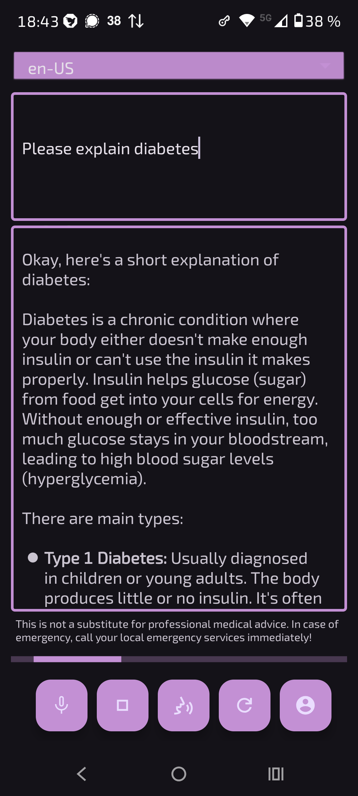
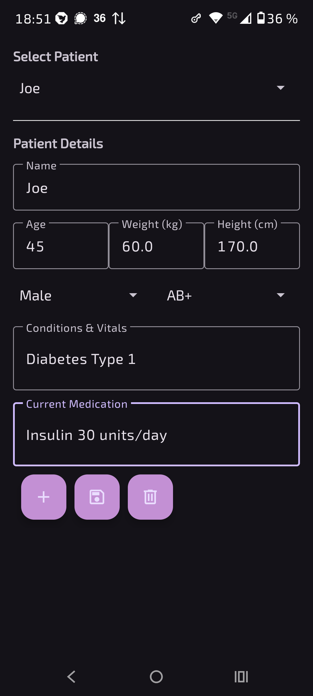

# medAssist: Offline Medical Assistant

> **⚠️ CRITICAL DISCLAIMER: READ BEFORE USING**
>
> **medAssist is NOT a medical device and does NOT provide medical advice.**
>
> This application is an **educational and informational tool only**. It uses a large language model (MedGemma) that can produce incorrect, outdated, or harmful information. It has no understanding of your personal medical history beyond what you type, cannot perform clinical judgment, and is not evaluated by any medical regulatory body.
>
> **NEVER rely on this app for diagnosis, treatment decisions, or emergency care. Always consult a qualified healthcare professional for medical concerns. In case of emergency, call your local emergency services immediately.**

---

## 📱 Overview

Discuss medical topics with your personal AI assistant. The assistant takes your existing conditions, vitals, and medication into account for context, but **does not replace professional medical judgment**.

- **100% Offline**: No internet required.
- **Privacy-First**: No data ever leaves your phone.
- **Powered by MedGemma**: Based on Google’s open-weight medical LLM.

  

---

## ⚖️ Legal & Liability

### User Responsibility
By using medAssist, you acknowledge and agree that:
1. You are **solely responsible** for how you use information from this app.
2. You will **consult qualified healthcare professionals** for any medical concerns.
3. You understand the **risks** of relying on AI-generated health information.
4. You accept **all risks** associated with using this software.
5. You will **not use this app** in emergency situations.

### No Warranty
This software is provided **"AS IS"** without warranty of any kind, express or implied, including but not limited to accuracy of medical information, fitness for a particular purpose, or non-infringement.

### Limitation of Liability
The developers, contributors, and distributors of medAssist shall **NOT be liable** for any direct, indirect, incidental, special, or consequential damages, including personal injury, illness, or death resulting from use or misuse of this software. **Use at your own risk.**

### License Terms
The use of the underlying MedGemma model is governed by the [Health AI Developer Foundations terms of use](https://developers.google.com/health-ai-developer-foundations/terms). You must accept these terms within the app before use.

---

## ✨ Features

| Feature                   | Description                                                                                  |
|---------------------------|----------------------------------------------------------------------------------------------|
| **100% offline**          | All inference runs locally via GGUF on-device model execution                                |
| **Privacy-first**         | Zero network calls, no internet permission — your text never leaves the device               |
| **Voice input**           | Install Whisper+ from F-Droid for this feature or any other voice input that supports intent |
| **Voice output**          | Via system text-to-speech. It is recommended to use SherpaTTS from F-Droid                   |
| **System theme**          | Follows your device's light/dark setting automatically                                       |

---

## 🤖 Model Setup

The app requires a MedGemma GGUF model file at runtime. On first launch, you are redirected to the **Setup Activity** where you must accept the license terms.

### 1. Download Model
Tap **Download**, which opens Hugging Face in your browser. We recommend the `medgemma-1.5-4b-it-Q4_K_M.gguf` model for a balance of performance and size.

### 2. Install Model
Tap **Install Model**, select the `.gguf` file from your device using the system document picker, and the app copies it into its private storage.

### 3. Start
Once the model is in place, tap **Start** to launch the assistant.

---

## 🛠️ Technical Details

- **Inference Engine**: [SmolLM Android](https://github.com/shubham0204/SmolChat-Android) based on [llama.cpp](https://github.com/ggml-org/llama.cpp)
- **Model Format**: GGUF (Quantized Q4_K_M recommended)
- **Language**: Java/Kotlin (Android)
- **Markdown Rendering**: [Markwon](https://github.com/noties/Markwon)

---

## 🙏 Acknowledgements

- **[Google Research](https://huggingface.co/collections/google/medgemma-release)** — MedGemma models (Health AI Developer Foundation's terms of use)
- **[shubham0204](https://github.com/shubham0204/SmolChat-Android)** — SmolLM Android inference engine (Apache 2.0 license)
- **[mradermacher](https://huggingface.co/mradermacher)** — Quantized TranslateGemma GGUF model weights (Gemma license)
- **[llama.cpp](https://github.com/ggml-org/llama.cpp)** — LLM inference in C/C++ (MIT license)
- **[Markwon](https://github.com/noties/Markwon)** — Markdown conversion 

---

## 🆘 Emergency Information

**If you are experiencing a medical emergency:**
- **Call your local emergency number immediately** (911 in US/Canada, 112 in EU, 999 in UK, etc.)
- **Do NOT use this app** for emergency decision-making.
- **Go to the nearest emergency room** or urgent care facility.

For reliable health information, consider official sources like the [WHO](https://www.who.int/), [CDC](https://www.cdc.gov/), or your country's national health service.
